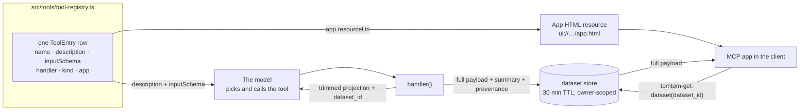
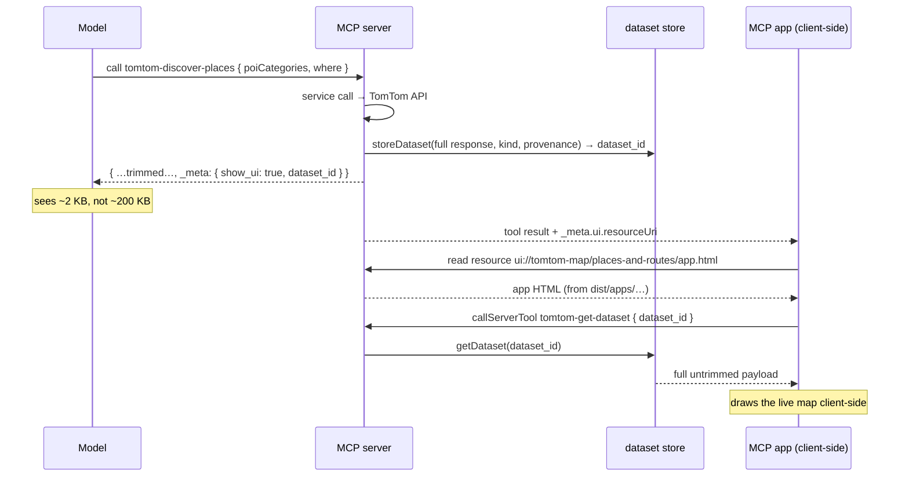
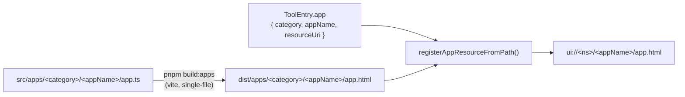
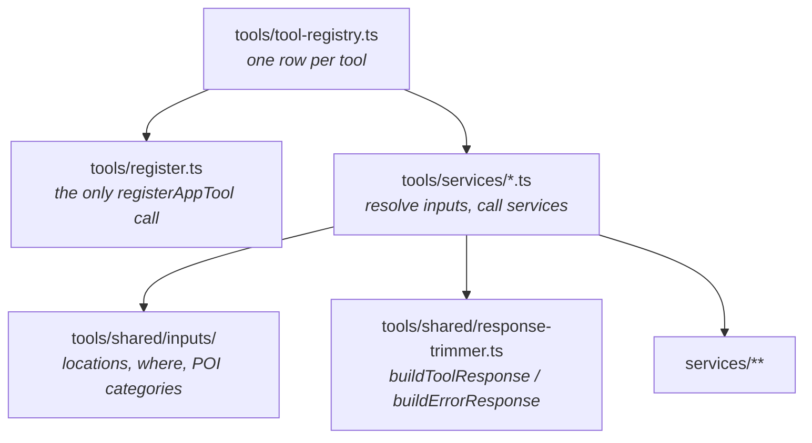
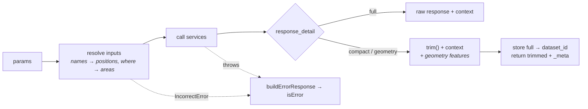

# Tool architecture

How the MCP tool layer is put together, and how tools relate to MCP apps.

- To **add** a tool, follow [`../Adding_new_tools.md`](../Adding_new_tools.md).
- For where the tool surface is **heading**, see
  [`proposals/agent-toolkit-alignment.md`](./proposals/agent-toolkit-alignment.md).

---

## Two audiences, one tool

Every data tool serves two consumers at once, and almost every design decision in
this layer follows from that:

| | The **model** | The **MCP app** |
| --- | --- | --- |
| Wants | The smallest text that answers the question | The full, untrimmed payload to draw |
| Gets | A trimmed projection + a `dataset_id` | The same `dataset_id`, redeemed for the full data |
| Cares about | `description`, `inputSchema` | `_meta.ui.resourceUri`, the stored payload |
| Cost of getting it wrong | Wrong tool picked, or context blown | Nothing to render |

A single tool call therefore produces **two different views of one result**. The
server renders no images: it builds state, stores it, and hands out a key.

A `dataset_id` is a read handle, so the store is owner-scoped and byte-capped
(§ Dataset residency).



### The full round trip



Consequences worth internalising:

1. **`show_ui: false` still stores**, so the handle is valid for any consumer.
2. **The TTL is 10 minutes**, overridable with `DATASET_TTL_SECONDS`.
   `src/apps/shared/decompress.ts` keeps a `localStorage` copy so a conversation
   reopened after a server restart can draw.
3. **Datasets are owner-scoped.** Keyed by a digest of the resolved API key — never
   the key itself. Another principal's `dataset_id` returns the same "not found" as
   a genuine miss, deliberately, so the store cannot be probed for which ids exist.
4. **There is a byte budget.** `node-cache` bounds only time. Entries carry an
   estimated size (extrapolated from the summary sample — serialising 50 MB to
   measure it would cost more than the fetch) and the oldest are evicted past
   256 MB or 500 entries.
5. **Clients without app support degrade to text.** They still get the trimmed
   projection; they just never redeem the `dataset_id`.

### Why three tools are hidden from the model

`tomtom-get-api-key`, `tomtom-get-app-config` and `tomtom-get-dataset` exist
*only* to serve the apps. They are registered with `visibility: "app"`, which
`register.ts` turns into `_meta.ui.visibility = ["app"]`, and a non-app client
never sees them. `evals/harness/transport.test.ts` asserts that over a real
transport — a leak would put "fetch the raw payload" in the model's toolbox and
undo the entire trimming design.

### Apps are built separately from the server



All 8 model-visible tools declare an app, and 4 apps are built: the five search and
routing tools share `PLACES_AND_ROUTES_APP`. A built app no row references is an orphan.

The registry row is the only link between a tool and its app. `app.category` and
`app.appName` locate the built HTML on disk; `app.resourceUri` is what the tool
advertises and the resource registers under. Get them out of step and the app
resolves to the "App not found — run `npm run build:apps`" placeholder rather than
failing loudly, so `tool-registry.test.ts` asserts the URI is derived from
`appName`.

> **Orphaned apps are silent.** Nothing warns when an app directory has no
> registry row — the build just keeps shipping it. Retiring a tool, or removing a
> row's `app`, deletes its `src/apps/<category>/<appName>/` in the same commit.

---

## Layering

The tool layer is a table plus two shared functions.



| Concern | Lives in |
| --- | --- |
| Tool metadata (name, description, schema, annotations, app) | one row in `tool-registry.ts` |
| `registerAppTool` | called once, in `register.ts` |
| Annotations | `READ_ONLY_ANNOTATIONS`, applied once |
| Response shaping (`full` / `geometry` / compact, dataset write) | `buildToolResponse()` |
| `catch` + `handleApiError` + log | `buildErrorResponse()` |
| Token-saving projections | `tools/shared/response-trimmer.ts` |
| API key | `requireApiKey()` |

### Anatomy of a registry row

```ts
{
  name: "tomtom-discover-places",     // what the model calls
  title: "TomTom Discover Places",    // client UI + annotations.title
  description: "Find places — businesses, POIs, addresses — in an area…", // drives tool selection
  inputSchema: tomtomDiscoverPlacesSchema, // Zod raw shape
  handler: discoverPlacesHandler,
  kind: "places",                     // the dataset kind it stores
  app: PLACES_AND_ROUTES_APP,         // its MCP app
  tags: ["search", "discover", "place", "EV", "along-route", "coverage"],
  examplePrompts: [                   // ← the eval corpus, not decoration
    "Find Italian restaurants in Amsterdam",
    "Where can I stop for coffee on the drive from Amsterdam to Brussels?",
  ],
  relatedTools: ["tomtom-locate-place", "tomtom-poi-categories"],
}
```

`examplePrompts` is load-bearing: `evals/scenarios/` reads it through
`getDefaultToolPrompts()`, so a prompt added here becomes a tool-selection test on
the next run, and `tool-registry.test.ts` fails if any model-visible tool has
none. `tags` / `relatedTools` / `dependsOn` share their vocabulary with the agent
toolkit's registry so the two surfaces can be compared field by field.

### The response pipeline



A handler resolves its inputs, calls the services, and passes the raw result to
`buildToolResponse` with its trim, its geometry builder and its `context` (where
inputs resolved, what was searched — kept at every detail level).
`buildToolResponse` owns the `full` escape hatch, the dataset write and the
minified JSON; `buildErrorResponse` owns error shaping. Bad input is an
`IncorrectError` thrown inside the handler's `try`.

`poiCategoriesHandler` builds its own response (a small static lookup — nothing
to store, nothing to trim), and `dataVizHandler` has no upstream API call and
returns a *summary* rather than data.

### Layout

```
src/
├── apps/                        # MCP app sources — built to dist/apps/
│   ├── <category>/<appName>/    #   map/, traffic/, data-viz/
│   └── shared/                  #   api-key, decompress (dataset_id → full data), map-controls
├── schemas/                     # Zod raw shapes — the model-facing input contract
├── services/
│   ├── api-key.ts               # key resolution + server identity
│   ├── datasets/
│   │   ├── dataset-store.ts     # the dataset_id store (owner-scoped, byte-capped)
│   │   ├── geojson.ts           # shared FeatureCollection normalisation
│   │   └── summarize.ts         # describe data without shipping it
│   └── search|routing|traffic|map/
├── tools/
│   ├── tool-registry.ts         # ← THE TABLE. Start here.
│   ├── register.ts              # the only registerAppTool call
│   ├── tool-tags.ts             # tag vocabulary, shared with the agent toolkit
│   ├── app-tools.ts             # the 3 app-only handlers
│   ├── services/                # per-tool handlers
│   └── shared/
│       ├── tool-entry.ts        # ToolEntry, READ_ONLY_ANNOTATIONS
│       ├── inputs/              # locations, where, POI categories
│       ├── response-trimmer.ts  # every token-saving projection + the response builders
│       └── resource-registry.ts # app HTML → MCP resource
├── createServer.ts              # builds McpServer, calls registerTools()
├── index.ts / indexHttp.ts      # stdio / HTTP entry points
└── evals/                       # model-in-the-loop tests (see evals/README.md)
```

---

## The tool surface

**8 model-visible tools + 3 app-internal.** All are read-only, idempotent
lookups, so `READ_ONLY_ANNOTATIONS` applies to every one.

| Tool | `kind` | App |
| --- | --- | --- |
| `tomtom-discover-places` | places | ✓ |
| `tomtom-locate-place` | places | ✓ |
| `tomtom-reverse-geocode` | places | ✓ |
| `tomtom-poi-categories` | — | ✓ |
| `tomtom-plan-route` | routes | ✓ |
| `tomtom-get-traffic` | incidents | ✓ |
| `tomtom-dynamic-map` | mapState | ✓ |
| `tomtom-data-viz` | byod | ✓ |
| `tomtom-get-api-key` | — | app-only |
| `tomtom-get-app-config` | — | app-only |
| `tomtom-get-dataset` | — | app-only |

Shared input machinery lives in `src/tools/shared/inputs/`:

- the **location** input — a place name (`{ query, queryAs }`) or a `{ position }` —
  accepted by every tool that means "a place";
- the **`where`** resolver: `within` resolves city, district or neighbourhood names to
  boundary polygons, `nearby` a point or landmark plus a radius, `maxDetour` a drive
  between locations, `global` nothing;
- **POI categories** in natural language, through the SDK's `resolvePOICategories`.

They are what let one search tool replace six, and `plan-route` and `get-traffic`
reuse them, so naming a place or an area works identically everywhere.

> **One tool, one app.** The MCP UI resource is bound to the tool DEFINITION, not
> the result — so a tool cannot pick its renderer at call time. That is why
> `dynamic-map` and `data-viz` are still separate: merging them means merging two
> substantially different renderers, not just their schemas.

### Where it is heading

Computing over a result on the server, and holding results the model can refer back
to, are the next steps:
[proposals/agent-toolkit-alignment.md](./proposals/agent-toolkit-alignment.md).

---

## Dataset residency: what is bounded, what is not

Datasets hold a whole tool result in process memory so the app can draw it. That makes the store the one component whose behaviour
differs sharply between a laptop and `mcp.tomtom.com`, and the difference is not
visible from the tool surface. Recorded here because none of it is solved, and
the parts that look solved are the ones worth reading twice.

### Where the bounds are

`src/services/datasets/dataset-store.ts` enforces four:

| Bound | Value | Overridable |
| --- | --- | --- |
| Retention | `DATASET_TTL_SECONDS`, 10 min | env |
| Process bytes / entries | 256 MB, 500 | no |
| Per-caller bytes / entries | 64 MB, 100 | no |

Eviction takes from the writing owner first, then from the heaviest owner
overall — oldest-first across the whole store would empty the light tenants while
the heavy one keeps everything it just wrote.

### The accounting is serialized size; the cost is heap

`estimateBytes()` extrapolates `JSON.stringify(sample).length`. What is retained
is the parsed object graph — `useClones: false`, so the store holds the same
structure the tool returned — and in V8 that is typically **2–5× the serialized
size**. A 256 MB budget can therefore correspond to roughly 0.5–1.5 GB of
old-space, and `data-viz` accepts a 50 MB URL fetch that the cap records as 50 MB
and that may hold five times that.

The caps bound the ACCOUNTING. Nothing in the process relates them to RSS. A
container should set `--max-old-space-size` explicitly and derive
`MAX_TOTAL_BYTES` from it, so the two are connected by construction rather than
by hope.

### Ownership is the API key, which is not always a person

`currentOwner()` is a digest of `getEffectiveApiKey()`, and that resolves to the
per-request session key **or**, failing that, the server's own static key. Two
consequences worth stating plainly:

1. **Under OAuth the key is project-scoped.** `ulsApiKeyResolver` exchanges a
   bearer token for a key scoped to a project and product bundle, so colleagues
   on one project may share an owner. They then share a per-caller budget — one
   evicts the others — and a `dataset_id` from one is readable by another. The
   ids are 8 random bytes so this is not a practical enumeration risk, but the
   isolation boundary is the PROJECT while the code says "the caller".
2. **The static-key fallback collapses tenants.** Any store or read that happens
   outside the `runWithSessionContext` scope — deferred work, a timer, an
   unawaited promise — attributes to the server's own key, and every such call
   shares one owner. In HTTP mode that should be a refusal rather than a
   fallback; `isHttpMode` already exists to tell the two apart.

Fixing the first means owning by authenticated principal (hash the bearer
subject) rather than by the credential it exchanges for.

### The shapes of the two deployments

**stdio.** One user, one process, one owner — so the 64 MB per-caller cap binds
and the 256 MB process cap is unreachable. That is stricter than the single-user
case needs: one 50 MB BYOD upload nearly fills the budget and a second dataset
evicts it. The host is someone's laptop running a desktop client, so the cost of
being generous is theirs alone and the cost of being stingy is a workflow that
stops working.

**Hosted.** Bounds are per POD. N pods hold N × 256 MB, a follow-up landing on
another pod misses entirely, and the store is the only backpressure on dataset
creation — nothing rate-limits it per token. Under load the heaviest legitimate
tenant is the one trimmed, which is the right choice and still means availability
degrades rather than failing loudly. Note also that `enforceOwnerBudget` and
`enforceGlobalBudget` each sort every entry in the store on every write; fine at
500 entries, and the first thing to fix if the caps are raised.

### Where this could go: persistence as a product dimension

The current design has one retention policy for everyone, which is the wrong
shape for both ends of the range. Two directions, neither implemented:

**Build- or mode-scoped defaults.** A local server could be far more generous —
higher caps, longer TTL, possibly a disk-backed store surviving a restart —
because the memory is the user's own and there is no tenant to protect. The caps
are constants today; making them a function of `isHttpMode` is the smallest
version of this.

**Retention as an entitlement.** Once ownership is the authenticated principal
rather than a shared key, retention and budget become per-principal attributes
rather than global constants: a free tier gets minutes and tens of megabytes, a
paid tier gets hours, larger budgets, and datasets that survive a pod restart
because they are backed by something outside the process. That reframes datasets
from an optimisation into a product surface — "your analysis is still there
tomorrow" is a feature people pay for, and it is the same mechanism that fixes
the multi-pod miss.

Both depend on the ownership question above being settled first. A tier attached
to a project-scoped key gives every colleague the same allowance and the same
namespace, which is not what anyone means by a per-user quota.

---

## Testing the tool layer

| What | Where | Needs |
| --- | --- | --- |
| Registry invariants (unique names, tags in vocabulary, `relatedTools` resolve, URI derived from `appName`, every tool has prompts) | `src/tools/tool-registry.test.ts` | — |
| Registration (all rows registered once, annotations applied, app resources, visibility) | `src/tools/register.test.ts` | — |
| Real `McpServer` boots and exposes the exact 8-tool model-visible surface | `src/createServer.smoke.test.ts` | — |
| Per-tool `execute` / `project` | `src/tools/services/*.test.ts` | — |
| Tools work over the wire, no model | `tests/test-stdio-tools.js`, `tests/test-http-tools.js` | API key |
| Wire surface == registry | `evals/harness/transport.test.ts` | `pnpm build` |
| Does a model pick the right tool? | `evals/scenarios/` | model key |
| Can a model actually answer? | `evals/capability/` | model + API key |
