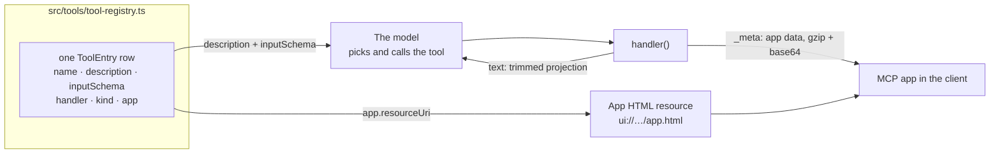
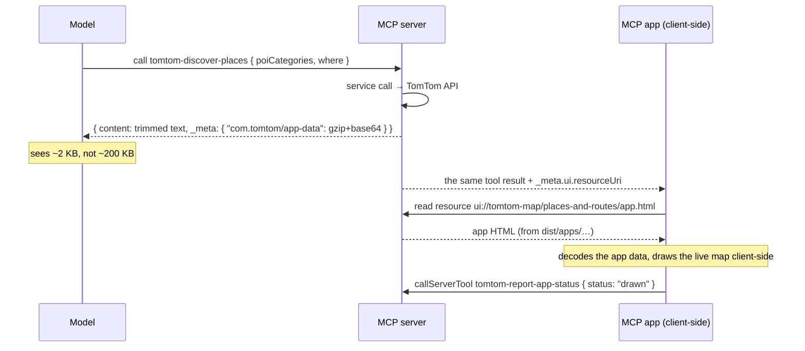
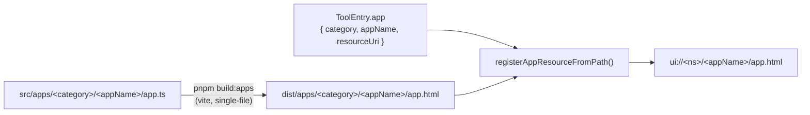
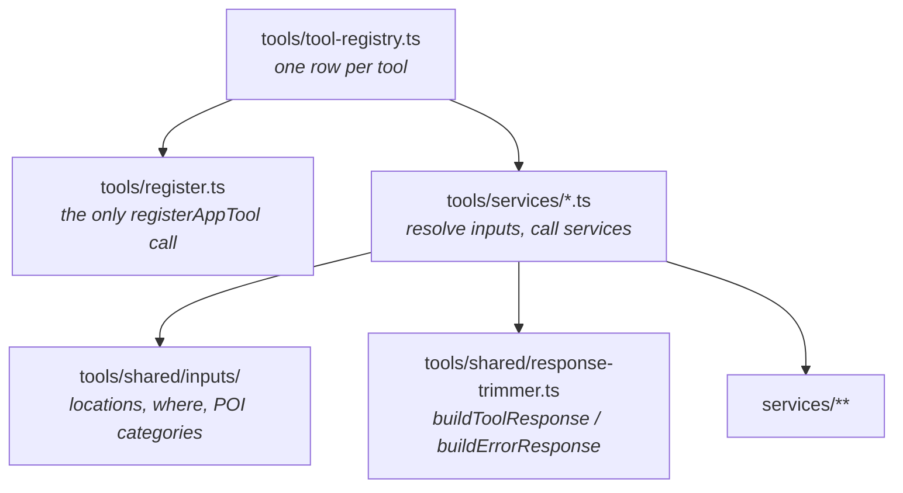
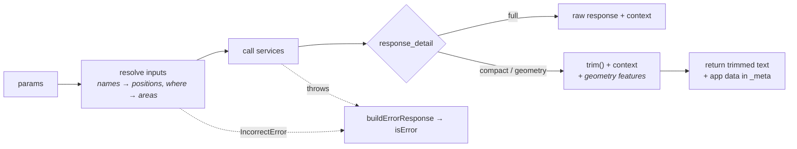

# Tool architecture

How the MCP tool layer is put together, and how tools relate to MCP apps.

- To **add** a tool, follow [`../Adding_new_tools.md`](../Adding_new_tools.md).
- For where the tool surface is **heading**, see
  [`proposals/agent-toolkit-alignment.md`](./proposals/agent-toolkit-alignment.md).

---

## Two audiences, one tool

Every data tool serves two consumers at once, and almost every design decision in
this layer follows from that:

| | The **model** | The **MCP app** |
| --- | --- | --- |
| Wants | The smallest text that answers the question | The full, untrimmed payload to draw |
| Gets | A trimmed projection in the result's text | The untrimmed data, gzipped in the same result's `_meta` |
| Cares about | `description`, `inputSchema` | `_meta.ui.resourceUri`, `_meta["com.tomtom/app-data"]` |
| Cost of getting it wrong | Wrong tool picked, or context blown | Nothing to render |

A single tool call therefore produces **two different views of one result**. The
server renders no images and keeps nothing: it builds state and returns it with
the text ([ADR 0009](./adr/0009-app-data-in-the-tool-result.md)).



### The full round trip



Consequences worth internalising:

1. **The whole result stays under 120,000 characters**, the most Claude inlines.
   `buildCompressedResponse` simplifies route lines until it fits; data that still
   doesn't fit is left out, and the app shows an error.
2. **A TomTom tool never runs again for its app.** That would be a second billed
   request. Only `tomtom-data-viz`, whose registry row sets `refetch`, runs again
   through `tomtom-get-app-data`, and it only downloads `data_url` again.
3. **The API key never travels in app data.** The maps-sdk echoes its request into
   the features it returns, so `buildCompressedResponse` strips credential-named
   properties first (`src/utils/redact.ts`).
4. **Clients without app support degrade to text.** They get the trimmed
   projection and no `_meta`.

### Why four tools are hidden from the model

`tomtom-get-api-key`, `tomtom-get-app-config`, `tomtom-get-app-data` and
`tomtom-report-app-status` exist *only* to serve the apps. They are registered
with `visibility: "app"`, which `register.ts` turns into
`_meta.ui.visibility = ["app"]`, and a non-app client never sees them. A leak
would put "fetch the raw payload" in the model's toolbox and undo the entire
trimming design.

### Apps are built separately from the server



All 8 model-visible tools declare an app, and 4 apps are built: the five search and
routing tools share `PLACES_AND_ROUTES_APP`. A built app no row references is an orphan.

The registry row is the only link between a tool and its app. `app.category` and
`app.appName` locate the built HTML on disk; `app.resourceUri` is what the tool
advertises and the resource registers under. Get them out of step and the app
resolves to the "App not found — run `npm run build:apps`" placeholder rather than
failing loudly, so `tool-registry.test.ts` asserts the URI is derived from
`appName`.

> **Orphaned apps are silent.** Nothing warns when an app directory has no
> registry row — the build just keeps shipping it. Retiring a tool, or removing a
> row's `app`, deletes its `src/apps/<category>/<appName>/` in the same commit.

---

## Layering

The tool layer is a table plus two shared functions.



| Concern | Lives in |
| --- | --- |
| Tool metadata (name, description, schema, annotations, app) | one row in `tool-registry.ts` |
| `registerAppTool` | called once, in `register.ts` |
| Annotations | `READ_ONLY_ANNOTATIONS`, applied once |
| Response shaping (`full` / `geometry` / compact, app data) | `buildToolResponse()` |
| `catch` + `handleApiError` + log | `buildErrorResponse()` |
| Token-saving projections | `tools/shared/response-trimmer.ts` |
| API key | `requireApiKey()` |

### Anatomy of a registry row

```ts
{
  name: "tomtom-discover-places",     // what the model calls
  title: "TomTom Discover Places",    // client UI + annotations.title
  description: "Find places — businesses, POIs, addresses — in an area…", // drives tool selection
  inputSchema: tomtomDiscoverPlacesSchema, // Zod raw shape
  handler: discoverPlacesHandler,
  kind: "places",                     // the kind of data it returns
  app: PLACES_AND_ROUTES_APP,         // its MCP app
  examplePrompts: [                   // ← the eval corpus, not decoration
    "Find Italian restaurants in Amsterdam",
    "Where can I stop for coffee on the drive from Amsterdam to Brussels?",
  ],
  relatedTools: ["tomtom-locate-place", "tomtom-poi-categories"],
}
```

`examplePrompts` is load-bearing: `getDefaultToolPrompts()` hands it to the
tool-selection evals, so a prompt added here becomes a selection test, and `tool-registry.test.ts` fails if any model-visible tool has
none. `relatedTools` shares its vocabulary with the agent
toolkit's registry so the two surfaces can be compared field by field.

### The response pipeline



A handler resolves its inputs, calls the services, and passes the raw result to
`buildToolResponse` with its trim, its geometry builder and its `context` (where
inputs resolved, what was searched — kept at every detail level).
`buildToolResponse` owns the `full` escape hatch, the app data and the
minified JSON; `buildErrorResponse` owns error shaping. Bad input is an
`IncorrectError` thrown inside the handler's `try`.

`poiCategoriesHandler` builds its own response (a small static lookup — nothing
to draw, nothing to trim), and `dataVizHandler` has no upstream API call and
returns a *summary* rather than data.

### Layout

```
src/
├── apps/                        # MCP app sources — built to dist/apps/
│   ├── <category>/<appName>/    #   map/, traffic/, data-viz/
│   └── shared/                  #   api-key, appData (decode the app data, report status), map-controls
├── schemas/                     # Zod raw shapes — the model-facing input contract
├── services/
│   ├── api-key.ts               # key resolution + server identity
│   ├── datasets/
│   │   ├── geojson.ts           # shared FeatureCollection normalisation
│   │   └── summarize.ts         # describe data without shipping it
│   └── search|routing|traffic|map/
├── tools/
│   ├── tool-registry.ts         # ← THE TABLE. Start here.
│   ├── register.ts              # the only registerAppTool call
│   ├── app-tools.ts             # the 4 app-only handlers
│   ├── services/                # per-tool handlers
│   └── shared/
│       ├── tool-entry.ts        # ToolEntry, READ_ONLY_ANNOTATIONS
│       ├── inputs/              # locations, where, POI categories
│       ├── response-trimmer.ts  # every token-saving projection + the response builders
│       ├── app-data.ts          # encode app data, fit it to the inline limit
│       └── resource-registry.ts # app HTML → MCP resource
├── createServer.ts              # builds McpServer, calls registerTools()
└── index.ts / indexHttp.ts      # stdio / HTTP entry points
```

---

## The tool surface

**8 model-visible tools + 4 app-internal.** All are read-only, idempotent
lookups, so `READ_ONLY_ANNOTATIONS` applies to every one.

| Tool | `kind` | App |
| --- | --- | --- |
| `tomtom-discover-places` | places | ✓ |
| `tomtom-locate-place` | places | ✓ |
| `tomtom-reverse-geocode` | places | ✓ |
| `tomtom-poi-categories` | — | ✓ |
| `tomtom-plan-route` | routes | ✓ |
| `tomtom-get-traffic` | incidents | ✓ |
| `tomtom-dynamic-map` | mapState | ✓ |
| `tomtom-data-viz` | byod | ✓ |
| `tomtom-get-api-key` | — | app-only |
| `tomtom-get-app-config` | — | app-only |
| `tomtom-get-app-data` | — | app-only |
| `tomtom-report-app-status` | — | app-only |

Shared input machinery lives in `src/tools/shared/inputs/`:

- the **location** input — a place name (`{ query, queryAs }`) or a `{ position }` —
  accepted by every tool that means "a place";
- the **`where`** resolver: `within` resolves city, district or neighbourhood names to
  boundary polygons, `nearby` a point or landmark plus a radius, `maxDetour` a drive
  between locations, `global` nothing;
- **POI categories** in natural language, through the SDK's `resolvePOICategories`.

They are what let one search tool replace six, and `plan-route` and `get-traffic`
reuse them, so naming a place or an area works identically everywhere.

> **One tool, one app.** The MCP UI resource is bound to the tool DEFINITION, not
> the result — so a tool cannot pick its renderer at call time. That is why
> `dynamic-map` and `data-viz` are still separate: merging them means merging two
> substantially different renderers, not just their schemas.

### Where it is heading

Computing over a result on the server, and holding results the model can refer back
to, are the next steps:
[proposals/agent-toolkit-alignment.md](./proposals/agent-toolkit-alignment.md).

---

## Testing the tool layer

| What | Where | Needs |
| --- | --- | --- |
| Registry invariants (unique names, `relatedTools` resolve, URI derived from `appName`, every tool has prompts) | `src/tools/tool-registry.test.ts` | — |
| Registration (all rows registered once, annotations applied, app resources, visibility) | `src/tools/register.test.ts` | — |
| Real `McpServer` boots and exposes the exact 8-tool model-visible surface | `src/createServer.smoke.test.ts` | — |
| Per-tool handlers | `src/tools/services/*.test.ts` | — |
| Tools work over the wire, no model | `tests/test-stdio-tools.js`, `tests/test-http-tools.js` | API key |
